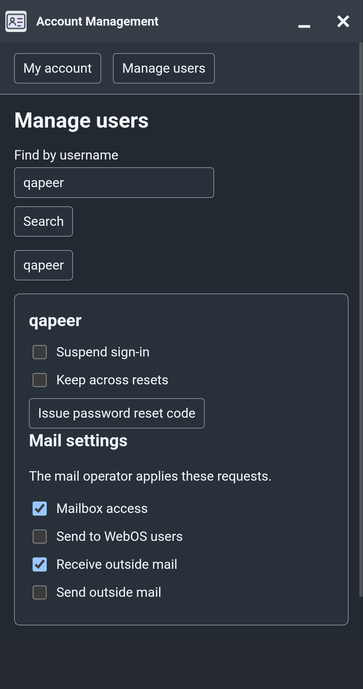

# Account Management phone qualification

Open **System Tools → Account Management**. The app loads `app.mjs` and `style.css` through the WebOS viewer and uses the Accounts service for sign-in and permissions. This pass used installed app source `cae09915` in a private QA installation on a Galaxy S10+ with Chrome `158.0.8127.92` at 411 CSS pixels.

The phone baseline covers three of seven account workflows. It exercises profile editing, self-service password change and administrator search and retention. Avatar upload, suspension, administrator reset codes and effective mail delivery remain separate tests.

1. With an ordinary account, open My account and save a display name. Open My account again and verify the name. The profile image and password controls are present. Manage users is absent.
2. With a disposable account, submit mismatched password confirmation. The app rejects it. Change the password with matching values. Sign in from a fresh browser context and verify that the new password works and the old one fails.
3. With an admin, open Manage users and search for a disposable peer. Enable Keep across resets and reload that user’s details. Confirm the saved grant, then restore the original setting. The page shows individual mailbox, internal send, outside receive and outside send controls.

The reusable QA display name and retention settings were restored after the tests.

